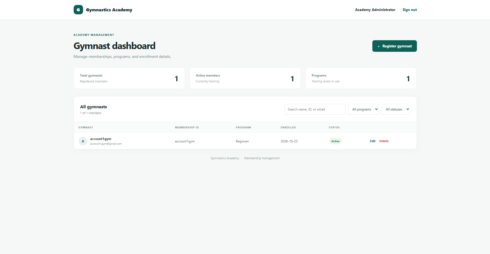
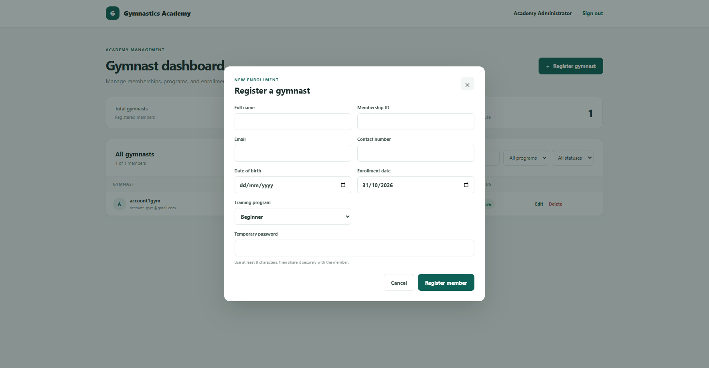
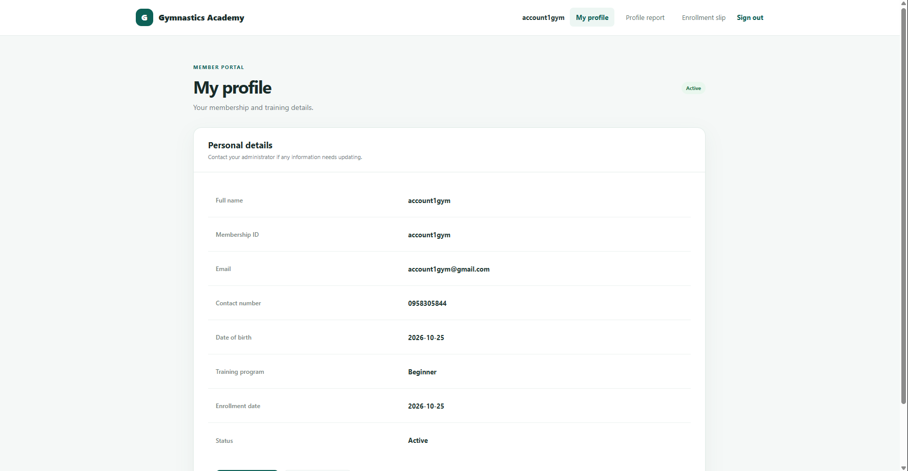
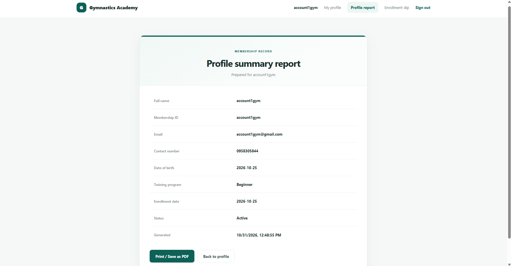
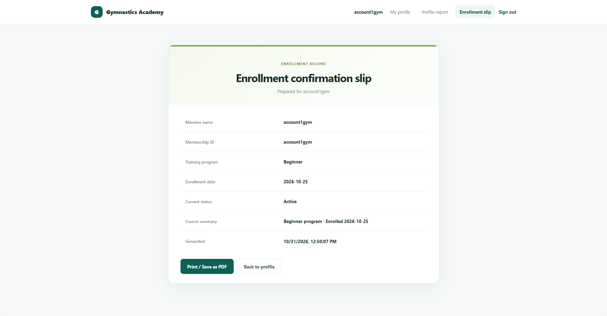

# Gymnastics Academy

A university assignment rebuilt as a portfolio-ready membership management app. React renders the login, administrator dashboard, and gymnast portal; PHP handles authentication and JSON requests; MySQL stores users and gymnast memberships.

## Features

- Administrator sign-in and role-protected dashboard
- Create, view, search, filter, edit, and delete gymnast records
- Gymnast sign-in, profile, printable profile report, and enrollment slip
- Password hashing, prepared SQL statements, input validation, role checks, and CSRF protection for dashboard changes
- Responsive React interface with a Vite development server and production build

## Screenshots

**Sign in**


**Administrator dashboard**



**Register a gymnast**



**Member portal**



**Profile report and enrollment slip**





## Stack

- React 18 and Vite
- PHP 8+ with PDO MySQL
- MySQL or MariaDB
- Node.js 20+ for the frontend development/build tools

Node.js is used only to build and serve the React frontend during development. The app backend is PHP; there is no separate Node API.

## Project layout

```text
database/
  schema.sql             Database tables and constraints
frontend/
  src/
    components/          Reusable form and status badge
    pages/               Login, admin dashboard, and gymnast portal
    css/                 Login, dashboard, and portal styles
    App.jsx              Restores the session and chooses the screen
    api.js               Sends requests to the PHP API
    main.jsx             Starts the React app
  vite.config.js         Vite development proxy and production build
php/
  public/
    api.php              The only HTTP entry point; routes requests to handlers
    app/                 Production React build (generated, not committed)
  src/
    handlers/            auth.php and gymnasts.php: one function per endpoint
    http.php             JSON responses, request body, CSRF check, session user
    validation.php       Input validation for gymnast data
    repository.php       SQL queries and transaction-safe database changes
    db.php               PDO database connection
  config/                config.php loader, config.example.php template
scripts/
  create-admin.php       One-time command-line administrator setup
storage/                 Deletion log (created when needed)
```

Only `php/public/` is meant to be served by a web server; the code in `php/src/` and the settings in `php/config/` stay outside the public web root.

## How the code works

### What happens when you sign in

1. `frontend/src/main.jsx` starts the React application in the page's `root` element and loads its styles.
2. `frontend/src/App.jsx` asks PHP for the current session. A signed-out visitor sees the React login form; an administrator sees the dashboard; a gymnast sees their member portal.
3. `frontend/src/api.js` sends browser requests to `php/public/api.php`. During development, Vite forwards `/api.php` requests to the PHP server on port 8000.
4. `php/public/api.php` routes the request to a handler in `php/src/handlers/`, which checks the session, role, and CSRF token where needed. It is the only HTTP entry point that reads or changes app data.
5. `php/src/db.php` opens a PDO connection using settings from the ignored `php/config/config.local.php`. `php/src/repository.php` contains the shared SQL operations for registering, listing, updating, and deleting gymnast records.

React controls what the user sees, but it does not grant permissions. PHP makes the permission checks before returning private data or changing the database.

### Main React files

- `frontend/src/App.jsx` checks the signed-in user and chooses the login page, admin dashboard, or gymnast portal.
- `frontend/src/pages/LoginPage.jsx` contains the sign-in form. `AdminDashboard.jsx` handles membership management, and `GymnastPortal.jsx` shows member profiles and printable reports.
- `frontend/src/components/GymnastForm.jsx` is the shared create/edit form, and `StatusBadge.jsx` displays a membership status.
- React state (`useState`) holds data and form values; `useEffect` loads data from PHP; `useMemo` recalculates the filtered list when its inputs change.
- `frontend/src/api.js` is the small HTTP client used by the screens. It sends the PHP session cookie and the CSRF header for changes.
- `frontend/src/main.jsx` is the browser entry point that mounts React and imports the stylesheets.
- `frontend/src/css/app.css` styles the dashboard and member portal; `frontend/src/css/login.css` styles the login screen.
- `frontend/vite.config.js` configures the local React development server and builds the production files.

### Main PHP files

- `php/public/api.php` is the router: it starts the session, then sends each request to the matching handler.
- `php/src/handlers/auth.php` handles session, login, and logout; `handlers/gymnasts.php` handles the profile and the admin member endpoints.
- `php/src/validation.php` validates request data, and `php/src/http.php` holds the shared response, CSRF, and session helpers.
- `php/src/repository.php` contains reusable queries and transaction-safe database changes.
- `php/src/db.php` creates the PDO database connection.
- `php/config/config.php` loads local settings or environment variables. `php/config/config.local.php` contains your machine's database settings and must remain private.
- `scripts/create-admin.php` is a one-time command-line helper to create an administrator; it is not needed to add gymnast accounts.
- `database/schema.sql` defines the MySQL tables and their relationships.

## Run locally on Windows with Laragon

Laragon provides MySQL and PHP; PHP's built-in development server serves the app, so the project does not need to be moved into Laragon's `www` folder and Apache is not required to run it.

### 1. Install Laragon

Download the **Full** Windows installer from the [official Laragon download page](https://laragon.org/download/). Install it to the default `C:\laragon` folder (or note the folder you choose). Open Laragon and choose **Start All** to start its services.

Laragon's full package includes PHP, MySQL, and Node.js. To use its PHP and Node.js commands in PowerShell, select **Tools > Path > Add Laragon to Path**, then open a new terminal. If Node.js is already installed, you can use that instead.

### 2. Create the database

In Laragon, select **Menu > MySQL > phpMyAdmin**. Import `database/schema.sql`; this creates `gymnastics_db` and the `users` and `gymnasts` tables.

If you already have a database with these tables and data, back it up first. The schema uses `CREATE TABLE IF NOT EXISTS` and will not modify existing tables.

### 3. Configure the database

Open a PowerShell terminal in the project root and copy the example configuration:

```powershell
Copy-Item php\config\config.example.php php\config\config.local.php
```

Edit `php\config\config.local.php` to match the MySQL username and password in Laragon. A default local Laragon MySQL installation often uses `root` with a blank password; confirm your own settings rather than assuming. This local config file is ignored by Git. Do not commit database credentials.

### 4. Create your first administrator (one time only)

You only do this once to create the admin account. From PowerShell in the project root, enter:

```powershell
$env:GYMNAST_ADMIN_EMAIL = Read-Host "Administrator email"
$securePassword = Read-Host "Administrator password" -AsSecureString
$passwordPointer = [Runtime.InteropServices.Marshal]::SecureStringToBSTR($securePassword)
try {
    $env:GYMNAST_ADMIN_PASSWORD = [Runtime.InteropServices.Marshal]::PtrToStringBSTR($passwordPointer)
    & 'C:\laragon\bin\php\php-8.3.36-Win32-vs16-x64\php.exe' scripts\create-admin.php
    if ($LASTEXITCODE -ne 0) { throw "Administrator setup failed." }
} finally {
    [Runtime.InteropServices.Marshal]::ZeroFreeBSTR($passwordPointer)
    Remove-Item Env:GYMNAST_ADMIN_EMAIL -ErrorAction SilentlyContinue
    Remove-Item Env:GYMNAST_ADMIN_PASSWORD -ErrorAction SilentlyContinue
}
```

The script uses Laragon's PHP and hashes the password before saving it. The minimum is 6 characters for this local assignment; a longer password is safer. After this one-time setup, create gymnast accounts from **Register gymnast** in the dashboard—no terminal command is needed for each member.

### 5. Start the app

Start MySQL in Laragon. You do not need to start Apache. Open **two PowerShell terminals** in the project folder:

**Terminal 1 — start PHP:**
```powershell
Set-Location 'C:\Projects\Portfolio-Projects\gymnastics'
& 'C:\laragon\bin\php\php-8.3.36-Win32-vs16-x64\php.exe' -S localhost:8000 -t php/public
```

**Terminal 2 — start React:**

```powershell
Set-Location 'C:\Projects\Portfolio-Projects\gymnastics\frontend'
npm run dev
```

Install frontend packages once, if you have not done so already, by running `npm install` in the `frontend` folder. Then open `http://localhost:5173` and sign in. Keep both terminal windows and Laragon's MySQL service running while you use the app; press Ctrl+C in each terminal to stop its server.

### Optional: create a production build

For local development, you do not need this step. Run `npm run build` in `frontend`; it writes the React app to `php/public/app/`. With the PHP server running, open `http://localhost:8000/app/`.

## Existing database notes

The supplied schema reflects the tables and fields used by the application code: `users` (`id`, `full_name`, `email`, `password`, `role`) and `gymnasts` (`id`, `user_id`, `membership_id`, `contact_no`, `date_of_birth`, `training_program`, `enrollment_date`, `status`). If your assignment database differs, back it up and compare its columns and constraints before importing or migrating.

## API overview

The session endpoint is public so the React app can tell whether it should show the login screen. Profile requests require the signed-in gymnast; member-management requests require an administrator. Login, logout, and data-changing requests require the CSRF token returned by `GET api.php?action=session`.

| Method | Endpoint | Purpose |
| --- | --- | --- |
| `GET` | `api.php?action=session` | Current signed-in user (if any) and CSRF token |
| `POST` | `api.php?action=login` | Sign in |
| `POST` | `api.php?action=logout` | Sign out |
| `GET` | `api.php?action=profile` | Get the signed-in gymnast's own profile |
| `GET` | `api.php?action=gymnasts` | Admin: list members |
| `POST` | `api.php?action=gymnasts` | Admin: register a member |
| `PUT` | `api.php?action=gymnasts&id=<id>` | Admin: update a member |
| `DELETE` | `api.php?action=gymnasts&id=<id>` | Admin: delete a member |

## Security and deployment

- Create local administrator credentials; no default account or password is included.
- Keep `php/config/config.local.php` private and use a least-privilege MySQL account outside local development.
- Serve the app over HTTPS in production and configure secure PHP session cookies.
- The deletion audit log is written to `storage/deleted_records.log`; keep that directory outside public access and make it writable by PHP.
- This is a learning/portfolio application. Review the code and add automated tests before using it with real personal data.
