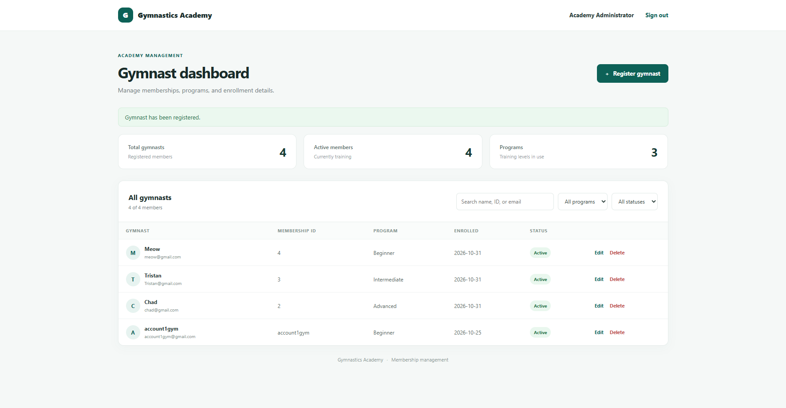
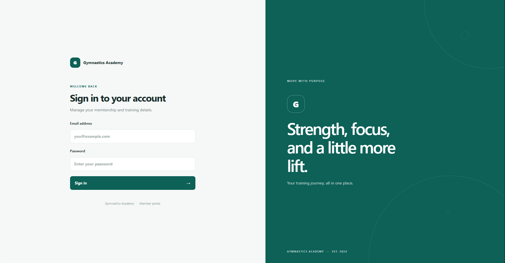

# Gymnastics Academy

A full-stack membership management app for a gymnastics academy. Administrators register and manage gymnasts; members sign in to view their own profile and print a profile report or enrollment slip.

It has a React frontend, a PHP JSON API, and a MySQL database, with a focus on secure sign-in, server-side validation, and a clean separation between the three layers.



## Features

- **Administrators:** sign in, then create, view, search, filter, edit, and delete gymnast records from a dashboard with membership summary cards
- **Members:** sign in to see their own profile, a printable profile report, and an enrollment confirmation slip
- **Security:** hashed passwords, prepared SQL statements, server-side validation, role checks on every request, CSRF protection, and HttpOnly/SameSite session cookies
- **Data integrity:** a member's account and profile are saved in one database transaction, and every deletion is written to an audit log
- **Responsive interface** built with React and Vite

## Tech stack

| Layer | Technology |
| --- | --- |
| Frontend | React 18, Vite |
| Backend | PHP 8+ (PDO), no framework |
| Database | MySQL or MariaDB |

Node.js is only needed to run and build the frontend. The backend is PHP, with no separate Node API.

## Screenshots

| Sign in | Register a gymnast |
| --- | --- |
|  |  |

| Member profile | Profile report |
| --- | --- |
|  |  |

| Enrollment slip |
| --- |
|  |

## How it works

1. `frontend/src/main.jsx` mounts the React app. `App.jsx` asks the API who is signed in, then shows the login page, the admin dashboard, or the member portal.
2. `frontend/src/api.js` is the only place that talks to the server. It sends the session cookie and a CSRF token with every change. In development, Vite proxies `/api.php` to the PHP server.
3. `php/public/api.php` is the single entry point. It starts the session, checks the user's role, and routes the request to a handler in `php/src/handlers/`.
4. Handlers validate input (`validation.php`) and run SQL through `repository.php`, which connects with `db.php`.

React decides what the user sees, but PHP decides what the user is allowed to do. Every permission check happens on the server.

### Design decisions

- **Separate API and frontend.** PHP exposes a small JSON API, so the interface and the data layer can change independently.
- **Only `php/public/` is web-facing.** Application code (`php/src/`) and configuration (`php/config/`) sit outside the public folder.
- **Prepared statements everywhere.** User input is never concatenated into SQL.
- **Transactions for multi-step changes.** Registering, updating, and deleting a member touch two tables, so either every step succeeds or none is saved.
- **One generic login error.** "Invalid email or password" is returned for both an unknown email and a wrong password, so attackers cannot discover which emails exist.
- **No default credentials.** The first administrator is created with a command-line script, and database settings come from a private local file or environment variables.

## Project layout

```text
database/
  schema.sql             Database tables and constraints
docs/screenshots/        Images used in this README
frontend/
  src/
    components/          Reusable form and status badge
    pages/               Login, admin dashboard, and member portal
    css/                 Login, dashboard, and portal styles
    App.jsx              Restores the session and chooses the screen
    api.js               Sends requests to the PHP API
    main.jsx             Starts the React app
  vite.config.js         Dev proxy and production build settings
php/
  public/
    api.php              The only HTTP entry point; routes requests to handlers
    app/                 Production React build (generated, not committed)
  src/
    handlers/            auth.php and gymnasts.php: one function per endpoint
    http.php             JSON responses, request body, CSRF check, session user
    validation.php       Input validation for gymnast data
    repository.php       SQL queries and transactions
    db.php               PDO database connection
  config/                config.php loader and config.example.php template
scripts/
  create-admin.php       One-time command-line administrator setup
storage/                 Deletion audit log (created when needed)
```

## Run it locally (Windows with Laragon)

Laragon provides PHP, MySQL, and Node.js. PHP's built-in server runs the app, so you do not need Apache or to move the project into Laragon's `www` folder.

### 1. Install Laragon

Download the **Full** installer from the [Laragon download page](https://laragon.org/download/) and install it to the default `C:\laragon` folder. Open Laragon and choose **Start All**.

To use PHP and Node.js from PowerShell, select **Tools > Path > Add Laragon to Path**, then open a new terminal. If Node.js is already installed, you can use that instead.

### 2. Create the database

In Laragon, select **Menu > MySQL > phpMyAdmin** and import `database/schema.sql`. This creates the `gymnastics_db` database with its `users` and `gymnasts` tables.

### 3. Configure the database connection

From the project root, copy the example file and edit it with your MySQL username and password:

```powershell
Copy-Item php\config\config.example.php php\config\config.local.php
```

A default Laragon install often uses `root` with a blank password; confirm your own settings. `config.local.php` is ignored by Git, so your credentials are never committed.

### 4. Create the first administrator (one time only)

```powershell
$env:GYMNAST_ADMIN_EMAIL = Read-Host "Administrator email"
$securePassword = Read-Host "Administrator password" -AsSecureString
$passwordPointer = [Runtime.InteropServices.Marshal]::SecureStringToBSTR($securePassword)
try {
    $env:GYMNAST_ADMIN_PASSWORD = [Runtime.InteropServices.Marshal]::PtrToStringBSTR($passwordPointer)
    php scripts\create-admin.php
    if ($LASTEXITCODE -ne 0) { throw "Administrator setup failed." }
} finally {
    [Runtime.InteropServices.Marshal]::ZeroFreeBSTR($passwordPointer)
    Remove-Item Env:GYMNAST_ADMIN_EMAIL -ErrorAction SilentlyContinue
    Remove-Item Env:GYMNAST_ADMIN_PASSWORD -ErrorAction SilentlyContinue
}
```

The password must be at least 8 characters and is hashed before it is saved. If `php` is not recognized, run Laragon's PHP by its full path instead, for example `C:\laragon\bin\php\php-8.3.36-Win32-vs16-x64\php.exe` (your version folder may differ). Gymnast accounts are created from **Register gymnast** in the dashboard; no terminal command is needed for them.

### 5. Start the app

Make sure MySQL is running in Laragon, then open two terminals in the project folder.

**Terminal 1: PHP API**

```powershell
php -S localhost:8000 -t php/public
```

**Terminal 2: React frontend**

```powershell
cd frontend
npm install   # first time only
npm run dev
```

Open <http://localhost:5173> and sign in. Press Ctrl+C in each terminal to stop.

### Optional: production build

Run `npm run build` in `frontend`. It writes the app to `php/public/app/`, and with the PHP server running you can open <http://localhost:8000/app/>.

## API overview

The session endpoint is public so the React app can tell whether to show the login screen. Profile requests need a signed-in gymnast, and member management needs an administrator. Login, logout, and every data-changing request require the CSRF token returned by `GET api.php?action=session`.

| Method | Endpoint | Access | Purpose |
| --- | --- | --- | --- |
| `GET` | `api.php?action=session` | Public | Current user (if any) and CSRF token |
| `POST` | `api.php?action=login` | Public | Sign in |
| `POST` | `api.php?action=logout` | Signed in | Sign out |
| `GET` | `api.php?action=profile` | Gymnast | Own profile |
| `GET` | `api.php?action=gymnasts` | Admin | List members |
| `POST` | `api.php?action=gymnasts` | Admin | Register a member |
| `PUT` | `api.php?action=gymnasts&id=<id>` | Admin | Update a member |
| `DELETE` | `api.php?action=gymnasts&id=<id>` | Admin | Delete a member |

## Security notes for deployment

- Keep `php/config/config.local.php` private and use a least-privilege MySQL account outside local development.
- Serve the app over HTTPS and set the session cookie `secure` flag in production.
- The deletion audit log is written to `storage/deleted_records.log`, outside the public folder. Make sure PHP can write to it.

## Limitations and next steps

- Add automated tests, starting with the validation functions
- Add continuous integration to build the frontend and lint the PHP on every push
- Add pagination for large member lists
- Deploy a live demo
